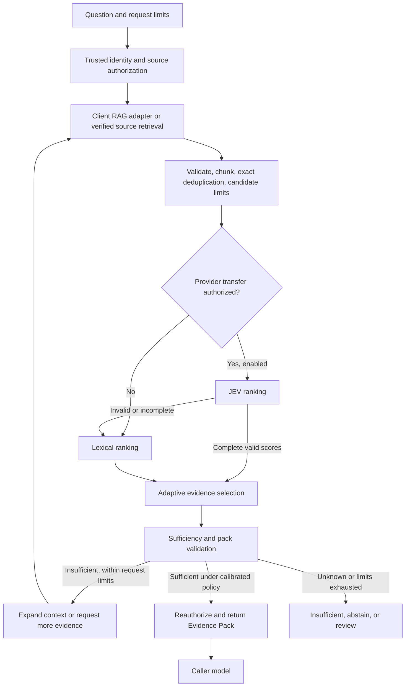

# ADR 0005 — Separate ranking from adaptive evidence selection

- Status: Proposed implementation design, following the repository audit of 2026-11-02.
- Audited revision: `c97ff096091311b002ad4e7379cb4edcd94c1d16`.
- Delivery plan and audit: [Arabic implementation plan](../EVIDENCE_OPTIMIZATION_PLAN_AR.md).
- Relationship: refines the selection and measurement portions of ADRs 0002–0004;
  preserves source authorization, provider-transfer authorization, and whole-request
  lexical fallback. It does not renumber the product roadmap.

## Decision

JEV supplies relevance scores and a ranking for an authorized candidate pool.
Evidence Layer owns candidate preparation, redundancy control, evidence selection,
budget enforcement, sufficiency assessment, provenance, and measurement. The caller
continues to generate the final answer. A relevance score is neither a factual
verification nor a probability that the available context is sufficient.

Evidence Layer is one shared optimization core for Document QA and Knowledge
Retrieval, Coding Agents and Vibecoding, and Complex Classification. Domain
profiles provide task-specific sufficiency policies and evaluation criteria around
the shared core; they do not create separate products or guarantee shared quality.
Each domain must pass its own evaluation and cost gates.

Optimize the serialized evidence pack's token count subject to authorization,
provenance, and a validated sufficiency policy. This is an approximate constrained
selection problem; the product must not promise a mathematically minimum pack or
guaranteed semantic completeness for arbitrary questions.

## Existing implementation to preserve

`selection.py` implements deterministic top-k. `LocalCorpusRetriever._apply_budget`
and `retrieve_verified_evidence` independently perform greedy whole-passage
selection using `len(text.split())`. A passage larger than the remaining budget is
skipped, and a nonempty result is sufficient for the current `ok` status.

`ProviderSelectionPolicy` deliberately prevents production JEV transfers. The
current benchmark permit is bound to the complete historical public dataset; it
must not be broadened or repurposed for customer requests or new benchmark inputs.
The service has authenticated evidence and source-content routes, but no HTTP
retrieval endpoint. The secure snapshot read composition is reusable; the standard
MCP path remains default-deny.

Several historical manifests fingerprint `schemas.py`, `metrics.py`, scorers, and
evaluation scripts. New contracts and evaluation code must initially live beside
them. Historical replays must use their pinned source revision. Never rewrite a
historical manifest to make a changed implementation appear to reproduce it.

## Request flow



Source-read denial terminates the operation under the current fail-closed
contract. It is not a reason to enter lexical fallback. Sources excluded by the
authorized catalog are never read; a revocation discovered after selection also
prevents delivery. Any future partial-source behavior needs an explicit contract.

## Proposed module boundaries

These files do not exist yet. Introduce them incrementally, without moving the
historical implementation in the first changes.

| File | Responsibility |
| --- | --- |
| `src/evidence_layer/optimization/contracts.py` | Versioned candidate, budget, assessment, and pack schemas; no credentials or authorization authority. |
| `src/evidence_layer/optimization/candidates.py` | Validate normalized candidates, preserve source spans, group exact duplicates, maintain retrieval and reranking limits. |
| `src/evidence_layer/optimization/tokenization.py` | Token counter interface, model/tokenizer identity, serialized-context measurement and estimated-count status. |
| `src/evidence_layer/optimization/selection.py` | Pure deterministic selection over already authorized and ranked candidates; no I/O. |
| `src/evidence_layer/optimization/sufficiency.py` | Runtime assessment interface, conservative initial implementation, missing query aspects and uncertainty. |
| `src/evidence_layer/optimization/pack.py` | Stable evidence serialization, citations, source-span validation, token-budget validation. |
| `src/evidence_layer/optimization/pipeline.py` | Bounded orchestration through injected retrieval, ranking, assessment and measurement interfaces. |
| `src/evidence_layer/optimization/measurement.py` | Attempt-level usage/cost records and cost completeness; no provider prices hard-coded into selection. |
| `services/evidence-service/evidence_service/evidence_pipeline.py` | Construct trusted request scope and connect secure source reads to the new core. |
| `services/evidence-service/evidence_service/provider_execution.py` | Future trusted JEV execution with exact transfer authorization and complete lexical fallback. |
| `scripts/run_evidence_efficiency_evaluation.py` | New versioned experiment runner; historical runners remain unchanged. |
| `scripts/verify_evidence_efficiency_evaluation.py` | Offline reproduction of the new experiment's inputs, selections, metrics and accounting. |

The pure core receives immutable, normalized inputs. The server derives tenant,
principal, ACL revision, policy, and transfer permission; client-provided metadata
cannot authorize reads or egress. Avoid one service per module: these are Python
boundaries inside the existing package and service.

## Versioned contracts

| Contract | Required information |
| --- | --- |
| `TaskProfile` | Task domain and subtype; profile and policy versions; selected sufficiency policy; applicable evidence requirements and criticality rules; evaluation track. It is not an authorization grant. |
| `PreparedCandidate` | Unique stable ID; parent candidate ID; source ID/version/digest; exact text and text digest; span coordinates with a declared coordinate system; retrieval rank and adapter identity; provenance status; allowed title/section; authorized duplicate aliases. |
| `RankedCandidateSet` | Complete candidate IDs, finite scores, deterministic rank, provider and returned model, scoring-input digest, fallback category. No mixed-provider scores within a request. |
| `SelectionBudget` | Soft and hard evidence-token limits; model context limit; non-evidence input allocation; reserved output and safety margin; retrieval and rerank limits; optional maximum selected count; maximum retrieval rounds and overall deadline. |
| `SufficiencyAssessment` | Result of the independent `SufficiencyAssessor` interface: `sufficient`, `insufficient`, or `unknown`; query aspects, support references, unresolved aspects/conflicts, task profile, assessor/policy version, and calibration status. Predicted support is explicitly distinct from gold coverage. |
| `EvidencePack` | Version, request ID, selected exact excerpts and citations, source versions/digests/spans, decision/reasons, assessment, counted rendered context, counting method, selection/scoring versions, expansion state and privacy-safe trace reference. |
| `UsageEvent` | Request/arm/stage/attempt ID; provider/model; usage categories; timestamps; outcome; price version/currency; measured or estimated cost; missing-cost reason. |

The ID of a derived chunk binds source version, text digest, parent identity, and
span. Preserve full citation mappings outside the model context; include compact
stable citation labels in the rendered pack and count those labels in its budget.
Deduplicated aliases remain inspectable without duplicating full source text.

`TaskProfile` selects a sufficiency policy by task domain and subtype. A trusted
application may set or validate the profile; a caller-provided task label is only
a routing hint and cannot expand source access or provider-transfer permission.
Profiles define what support must be present, how conflicts and missing evidence
are handled, what makes evidence critical, and which calibration/evaluation
version applies. The same selection algorithm can therefore serve all domains
without treating their sufficiency rules as interchangeable.

Customer RAG integration has two distinct trust levels: a trusted connector can
provide server-verified provenance; submitted text is only caller-attested until
independently checked. A URL or SHA supplied by a client does not establish source
integrity, ownership, or freshness. Do not fetch arbitrary submitted URLs.

Do not change the meaning of existing `budget_words`, `top_k`, or historical
`context_tokens_*` fields. Introduce a versioned pack contract and an explicit new
token budget. A proposed future endpoint is
`POST /v1/workspaces/{workspace_id}/evidence-packs`; it is not currently available.
An MCP adapter can consume the same new service composition after its own trusted
identity contract is implemented.

## Candidate preparation and ranking

1. Resolve and filter authorized source metadata before opening content. Recheck
   permissions at read, transfer, and delivery boundaries.
2. Retrieve from the customer's existing RAG or authorized snapshots. Treat
   lexical retrieval and lexical scoring fallback as separate responsibilities.
3. Chunk at paragraph/section boundaries with bounded overlap. Preserve headings,
   qualifying clauses, tables/code blocks, and offsets. Reconstructing a passage
   after chunking must not change its source meaning.
4. Remove exact same-content duplicates only within compatible source/version,
   provenance, and authorization scopes. Cross-source matches may share a scored
   representation only when their distinct provenance remains explicit. A near
   duplicate, a different version, or opposing evidence is not safe to discard
   solely because of lexical similarity.
5. Apply separately configured retrieval and reranking limits. Record candidates
   excluded by each stage so evaluation can locate recall losses.
6. Rank the complete admitted pool with JEV when a trusted host authorizes the
   exact query/text/metadata transfer. Validate unique IDs, cardinality, finite
   scores, model identity, timeout and response schema. On any failure discard
   every partial JEV score and recompute this entire pool lexically.

Tune candidate count, chunking, and allowed scoring metadata on development data.
Keep the scorer version fixed during selector comparisons. The current JEV
integration calls once per query/candidate pair: increased candidate counts incur
repeated query overhead. Batching is not assumed; bounded concurrency, if added,
must respect documented provider behavior and account for every attempted call.

## Selection and sufficiency

`AdaptiveSelector` is the shared, provider-independent core. It accepts a validated
ranked candidate set, a `TaskProfile`, the selected profile policy, and a serialized
token budget. It starts from high-ranked evidence, then considers marginal support
for unresolved profile requirements and redundancy. The selector handles budget,
diversity, provenance retention, and bounded expansion consistently across
domains; the profile-specific assessor decides whether the selected set meets the
task's support requirements. Similarity is a novelty signal, not proof of
entailment or duplication. Do not divide relevance by length as the sole objective:
this can systematically remove a long passage containing the only necessary
exception.

Evaluate long candidates against replacement of several shorter candidates and
against expansion up to the hard limit. Use dependencies for qualifying context
where an adapter can establish them. Preserve opposing evidence when a conflict
is detected; the absence of a detected conflict is not proof of consistency.
Perform a final removal pass only when the assessor still supports sufficiency.
For small labeled evaluation cases, an exhaustive subset oracle can quantify the
heuristic's gap; it must never supply production labels or drive the runtime path.

`SufficiencyAssessor` is an independent interface from `AdaptiveSelector` and is
configured by `TaskProfile`. Domain implementations can use explicit requirements
and structural support signals while sharing result contracts and orchestration.
`required_facts`, gold IDs, human relevance labels and answer keys are available
only to the evaluation process. They must never enter the runtime request,
TaskProfile, candidate metadata, selector, or assessor. At runtime the assessor
may use only the question, trusted domain constraints, authorized candidate
content, and policy permitted for that profile.

JEV scores estimate candidate relevance for ranking. They do not prove that a
candidate supports a required claim, that all task requirements are covered, or
that evidence is sufficient. The lexical ranking fallback has the same separation:
it recomputes the complete ranking, then invokes the domain's independently
evaluated sufficiency policy. A sufficiency policy is evaluated separately on
Lexical-ranked selections; JEV calibration or performance cannot be inherited by
the fallback path. If the applicable assessor has not been validated for the task
profile and ranking path, its result is `unknown`.

Each domain policy is calibrated and evaluated on its own representative data.
Document QA can require support for every requested fact and preserve source
provenance; coding tasks can require relevant symbols, dependencies, constraints,
and tests; classification can require discriminating fields, rules, exceptions,
and boundary evidence. These are evaluation definitions, not claims that those
assessors are implemented. A later semantic assessor is a separate measured
component, including its cost, latency, and transfer permission.

Only an assessor validated for the relevant workload can produce the actionable
`sufficient` status. Before that validation, use shadow mode. Preserve uncertainty
in the public pack; never convert `unknown` into `answer_with_context` merely
because the pack is nonempty, the token budget is full, or JEV assigned high
relevance scores. When the applicable policy cannot establish sufficient support,
retain `unknown` and follow that task profile's safe abstention or escalation path.

```text
prepare and rank authorized candidates
select with the soft budget
assess sufficiency and validate serialized pack
if sufficient: recheck delivery authorization, return pack
if soft budget caused missing support: retry selection up to hard budget
if missing support and retrieval can expand within limits:
    retrieve within the same authorized scope, re-prepare, rerank the full pool
    repeat within round, cost and time limits
otherwise: return insufficient_evidence / abstain / escalate_for_review
```

The orchestrator keeps a monotonic set of attempted query/source scopes and
candidate IDs, and stops on no new evidence. It cannot expand permissions,
silently raise the hard budget, or return a truncated pack as complete. Caller
RAG mode can return a bounded `retrieve_more` recommendation if it cannot invoke
retrieval itself. Cancellation and deadline expiry terminate further work.

## Token accounting

Let `H` be the model context window, `P` non-evidence input, `O` reserved output,
and `M` a safety margin. The effective hard evidence limit is
`min(request_hard_limit, H - P - O - M)`. Nonpositive capacity is an explicit
budget error. The caller must supply or reserve its own instructions, history,
tools and output requirements; Evidence Layer cannot infer unseen prompt content.

Count the exact rendered evidence string, including titles, labels, separators
and provenance shown to the model. Counting isolated passages and adding their
counts is not assumed equivalent to tokenizing the serialized pack. Record model,
tokenizer version and rendering version. Unsupported tokenizers return an explicit
estimate with a conservative policy or an unsupported-budget result; word counts
are never reported as measured tokens. Provider-reported usage remains the
benchmark authority for billable input/output tokens and is reconciled with local
counts, including caching and request framing differences.

## Validation and rollout

Require tests for source/tenant isolation, revoked grants during processing,
invalid provenance, malformed/partial JEV scores, fallback over the full pool,
cross-version duplicates, long indispensable passages, missing retrieval support,
contradictions, multilingual inputs, exact serialized budget, and bounded retries.
Test that removing gold labels from evaluation input cannot affect runtime output.

Evaluate candidate recall, ranking quality, fact coverage, full-support rate,
answer correctness/groundedness, false-sufficient rate, correct abstention, token
reduction, latency and complete serving cost separately. Compare against both
all-candidate RAG and a strong lexical selector at the same budget. Lower token
counts alone do not satisfy the release gate.

Roll out as offline replay, trusted lexical integration, shadow mode, then a
bounded canary after held-out quality and cost gates pass. Default activation,
provider egress and routing remain unchanged until their corresponding integration
work is complete. Rollback selects the previous versioned pipeline and retains
authorization checks and usage records.

## Consequences

Selection can improve without changing JEV. Provenance and budget become explicit
contracts, and failures become attributable to retrieval, ranking, selection,
assessment, or generation. The costs are additional evaluation labels, trustworthy
token counting, a calibrated assessor, and a trusted production provider host.
Some questions must retain more evidence or abstain, so token reduction is a
conditional outcome rather than a fixed percentage per request.
